# 💈 DKBZA Barber Studio

Sitio web multipágina, moderno y responsivo para barberías, desarrollado a partir de un diseño en Figma. Representa a **DKBZA Barber Studio** (Salta Capital, Argentina) y en la Unidad 4 se migró de HTML estático a **PHP**, con plantillas reutilizables, variables de entorno y procesamiento seguro de formularios. En la Clase 7 se agregó persistencia en **MySQL** con PDO y un CRUD de servicios en el Panel Admin.

## 🚀 Características
- **Dark Theme:** Estilo oscuro con tipografías `Inter` y `JetBrains Mono`.
- **10 vistas PHP:** Inicio, Nosotros, Servicios, Staff, Galería, Reservas, Reseñas, Tienda, Contacto y Panel Admin.
- **Diseño responsivo:** Adaptado para móviles y escritorio con CSS Grid/Flexbox y Bootstrap.
- **Interactividad (JS):** Validación de acceso para administradores, flujo de reservas y carrito de la tienda.
- **Plantillas PHP (SSI):** header, nav y footer compartidos por todas las páginas.
- **Navegación dinámica:** título de pestaña por página y resaltado de la sección activa en el menú.
- **Formularios procesados en el servidor (Clase 5):** contacto por `POST` y buscador de servicios por `GET`, con sanitización contra XSS, validación y mensajes al usuario.
- **Persistencia en MySQL (Clase 7):** los servicios se guardan en una base de datos y se administran desde el Panel Admin (alta, edición con imagen y baja), siempre con consultas preparadas (PDO).

## 🔄 Refactorización a PHP 

El proyecto partió de la maqueta estática en HTML del Hito 1 y se migró a PHP con:

- **Migración a `.php`**: todas las pantallas `.html` se renombraron a `.php` y se ejecutan en un servidor local (XAMPP).
- **Modularización (SSI)**: las secciones repetidas se extrajeron a plantillas reutilizables en `/includes/`:
  - `header.php`: `<head>`, metadatos, hojas de estilo y fuentes.
  - `nav.php`: menú de navegación principal.
  - `footer.php`: pie de página y carga de `script.js`.
  
  Cada página las incorpora con `include`.
- **Renderizado server-side (SSR)**:
  - **Título dinámico**: cada página define `$titulo_pagina` antes de incluir `header.php`, y ese valor se imprime en `<title>`.
  - **Menú activo**: `nav.php` detecta la página actual con `basename($_SERVER['PHP_SELF'])` y le agrega la clase `active` al enlace correspondiente.
- **Variables de entorno**: el archivo `.env` guarda el nombre de la empresa, el email de contacto y el entorno (`APP_ENV=local`). `config/env.php` lo lee y expone la función `env()`, que se usa en el footer, en la página de contacto y en el título por defecto. El `.env` está excluido en `.gitignore`, y `.env.example` sirve de plantilla. Además, `.htaccess` bloquea el acceso al `.env` desde el navegador.

## 🎨 Prototipo en Figma

🔗 [Ver diseño en Figma](https://www.figma.com/make/Oa6Kg84rj2VwZ5zH7AlGY3/Wireframe-para-DKBZA-Barber-Studio?t=gSs6taOH4TZWwJRP-1)

## 🛠️ Tecnologías utilizadas

- HTML5, CSS3, JavaScript (ES6+) y Bootstrap
- PHP 8.x
- MySQL / MariaDB con PDO (phpMyAdmin)
- XAMPP (Apache + MySQL)
- Prettier (formateo)
- Git y GitHub (ramas, commits y Pull Requests)

## 📁 Estructura del proyecto

Todo el sitio es **una sola aplicación** en la raíz del repositorio. Cada entrega anterior quedó marcada con una etiqueta de Git (ver [Entregas](#-entregas)).

```
Barberias/
├── config/
│   ├── env.php              ← Lee las variables del .env
│   └── conexion.php         ← Conexión PDO a MySQL
├── database/
│   ├── schema.sql           ← TP6: esquema relacional completo (tablas, PK, FK, índices)
│   ├── consultas.sql        ← TP6: datos de prueba y consultas CRUD / JOIN
│   ├── dkbza_db.sql         ← Script de la base y datos iniciales (TP7)
│   ├── seguridad.sql        ← Usuario MySQL con permisos mínimos
│   └── crear_admin.php      ← Crea un administrador (solo por terminal)
├── includes/
│   ├── header.php, nav.php, footer.php        ← Plantillas del sitio público
│   ├── admin_nav.php, admin_footer.php        ← Plantillas del panel
│   ├── form_servicio.php, funciones.php
│   ├── sesion.php           ← Sesión segura, tokens CSRF y cierre de sesión
│   └── auth_guard.php       ← TP8: verificarSesion() y verificarRol()
├── css/styles.css
├── js/script.js
├── img/
│   └── servicios/           ← Imágenes subidas desde el panel (no se suben a Git)
├── capturas/                ← Evidencia para el README
├── index.php, nosotros.php, servicios.php, staff.php, galeria.php,
│   reservas.php, resenas.php, tienda.php, contacto.php
├── registro.php             ← TP8: alta de usuarios
├── login.php / logout.php   ← TP8: ingreso con email y cierre de sesión
├── mi_cuenta.php            ← TP8: vista para cualquier usuario logueado
├── admin.php                ← Dashboard del panel (solo rol admin)
├── admin_servicios.php      ← CRUD: listado (Read)
├── crear_servicio.php       ← CRUD: alta (Create)
├── editar_servicio.php      ← CRUD: edición (Update)
├── eliminar_servicio.php    ← CRUD: baja (Delete)
├── .env.example             ← Plantilla de configuración
├── .htaccess                ← Bloqueo de archivos internos y cabeceras de seguridad
└── .gitignore
```

## 🏷️ Entregas

| Entrega | Etiqueta (versión entregada) | Pull Request |
|---|---|---|
| TP4: Migración a PHP con includes y `.env` | [`tp4`](https://github.com/ArapaDillan10/Pagina-para-barberias/tree/tp4) | [#3](https://github.com/ArapaDillan10/Pagina-para-barberias/pull/3) |
| TP5: Formularios y seguridad web | [`tp5`](https://github.com/ArapaDillan10/Pagina-para-barberias/tree/tp5) | [#4](https://github.com/ArapaDillan10/Pagina-para-barberias/pull/4) |
| TP6: Esquema relacional en MySQL | [`tp6`](https://github.com/ArapaDillan10/Pagina-para-barberias/tree/tp6) | [#8](https://github.com/ArapaDillan10/Pagina-para-barberias/pull/8) |
| TP7: MySQL, PDO, CRUD y login seguro | [`tp7`](https://github.com/ArapaDillan10/Pagina-para-barberias/tree/tp7) | [#5](https://github.com/ArapaDillan10/Pagina-para-barberias/pull/5) · [#6](https://github.com/ArapaDillan10/Pagina-para-barberias/pull/6) |
| TP8: Sesiones, autenticación y roles | [`tp8`](https://github.com/ArapaDillan10/Pagina-para-barberias/tree/tp8) | [#9](https://github.com/ArapaDillan10/Pagina-para-barberias/pull/9) |

Hasta el TP7 cada entrega estaba en su propia carpeta (`clase5/`, `clase7/`). Después se unificó todo en la raíz: las etiquetas permiten ver el código tal como se entregó.

## 🚀 Instalación y ejecución local

1. Instalar [XAMPP](https://www.apachefriends.org/) (PHP 8.x).
2. Clonar el repositorio dentro de `htdocs`:
   ```bash
   cd C:\xampp\htdocs
   git clone https://github.com/ArapaDillan10/Pagina-para-barberias Barberias
   ```
3. Crear el archivo de configuración a partir de la plantilla y completar los datos de la base (`DB_HOST`, `DB_NAME`, `DB_USER`, `DB_PASS`, `DB_CHARSET`):
   ```bash
   cd Barberias
   copy .env.example .env
   ```
4. Abrir el **XAMPP Control Panel** e iniciar **Apache** y **MySQL**.
5. Crear la base de datos: entrar a <http://localhost/phpmyadmin>, abrir la pestaña **SQL**, pegar el contenido de [`database/schema.sql`](database/schema.sql) y ejecutarlo. Después hacer lo mismo con [`database/consultas.sql`](database/consultas.sql), que carga los servicios y los datos de prueba.
   Luego ejecutar de la misma forma [`database/seguridad.sql`](database/seguridad.sql), reemplazando antes `CAMBIAR_ESTA_CLAVE` por una contraseña propia (solo en phpMyAdmin, no en el archivo). Esa misma contraseña va en `DB_PASS` del `.env`, con `DB_USER=dkbza_app`.
   Por último, crear el administrador desde la terminal (pide el nombre y la contraseña por teclado):
   ```bash
   C:\xampp\php\php.exe database\crear_admin.php admin@dkbza.com
   ```
6. Entrar desde el navegador a:
   - Sitio: <http://localhost/Barberias/>
   - Ingreso (admin y usuarios): <http://localhost/Barberias/login.php>
   - Crear cuenta: <http://localhost/Barberias/registro.php>

## 📸 Evidencia de funcionamiento

### Servidor local ejecutándose


### Estructura modular (SSI)


### Navegación dinámica (título + clase active)


### Configuración de variables de entorno


---

## 📝 Clase 5: Procesamiento de Formularios y Seguridad Web

Los formularios del sitio se procesan en el servidor con PHP. Versión entregada: etiqueta [`tp5`](https://github.com/ArapaDillan10/Pagina-para-barberias/tree/tp5).

🔗 **Probar localmente:** <http://localhost/Barberias/contacto.php> · <http://localhost/Barberias/servicios.php>

### 📂 Archivos modificados

```text
├── contacto.php     ← Formulario POST (contacto)
├── servicios.php    ← Formulario GET (buscador de servicios)
└── css/styles.css   ← Estilos de alertas y buscador
```

### 📨 Formulario POST: Contacto (`contacto.php`)

Formulario de contacto con los campos **nombre**, **email** y **mensaje**. Los datos se envían por `POST` a la misma página y se procesan en el servidor antes de mostrar el HTML.

- **Sanitización:** cada campo pasa por la función `limpiar()`, que aplica `trim()` y `htmlspecialchars()` para prevenir ataques XSS.
- **Validación en el servidor:**
  - `isset()` y `empty()` comprueban que los campos obligatorios no lleguen vacíos.
  - `filter_var($email, FILTER_VALIDATE_EMAIL)` valida el formato del correo.
  - El mensaje debe tener al menos 10 caracteres.
- **Mensajes al usuario:** un cuadro rojo lista todos los errores de validación y un cuadro verde confirma el envío exitoso.
- **Persistencia:** si hay errores, los campos conservan los valores ingresados (`value="<?php echo $nombre; ?>"`). Si el envío es exitoso, el formulario se vacía.
- El formulario usa `novalidate` para que la validación la haga el servidor (PHP) y no solo el navegador.

**Errores de validación (campos vacíos):**


**Persistencia de datos (email inválido y mensaje corto):**


**Protección contra XSS:** el código `<script>alert(1)</script>` se muestra como texto y no se ejecuta.


**Envío exitoso:**


### 🔍 Formulario GET: Buscador de Servicios (`servicios.php`)

Buscador que filtra los servicios de la barbería por nombre o descripción. El término viaja en la URL (por ejemplo, `servicios.php?buscar=barba`), así la búsqueda se puede compartir o guardar.

- Los servicios se almacenan en un array de PHP (`$servicios`) y las tarjetas se generan con `foreach`.
- **Sanitización:** el término se recibe con `filter_input(INPUT_GET, 'buscar', ...)` y se limpia con `trim()` y `htmlspecialchars()` antes de usarlo o mostrarlo.
- **Validación:** `isset()` y `empty()` determinan si se realizó una búsqueda. Si el campo está vacío, se muestran todos los servicios.
- **Filtrado:** `stripos()` busca coincidencias sin distinguir mayúsculas de minúsculas.
- **Mensajes al usuario:** se informa la cantidad de resultados o que no hubo coincidencias, con un enlace para volver a ver todos.
- **Persistencia:** el término buscado se mantiene en el campo de búsqueda.

**Resultados de la búsqueda:**


**Búsqueda sin resultados:**


---

## 🧩 Clase 6: Diseño del Esquema Relacional en MySQL

Se diseñó el modelo de datos completo de la barbería, aplicando normalización hasta la 3FN.

- Esquema: [`database/schema.sql`](database/schema.sql)
- Datos de prueba y consultas: [`database/consultas.sql`](database/consultas.sql)

### 📋 Tablas, claves primarias y foráneas

| Tabla | Tipo | PK | FK | Para qué sirve |
|---|---|---|---|---|
| `usuarios` | Usuarios | `id` | — | Clientes y administradores (`email` único, `password` con hash, `rol` admin/usuario) |
| `categorias` | Maestra | `id` | — | Agrupa los servicios: Corte, Barba, Combo |
| `barberos` | Maestra | `id` | — | Profesionales que atienden los turnos |
| `servicios` | Catálogo | `id` | `categoria_id` → `categorias.id` | Servicios que se muestran en el sitio y se administran desde el panel |
| `turnos` | Principal del negocio | `id` | `usuario_id` → `usuarios.id`<br>`barbero_id` → `barberos.id` | Reserva de un cliente con un barbero en una fecha y hora |
| `turno_servicio` | Detalle (N:M) | `id` | `turno_id` → `turnos.id`<br>`servicio_id` → `servicios.id` | Qué servicios incluye cada turno y a qué precio se cobraron |
| `login_intentos` | Seguridad | `id` | — | Intentos fallidos de login, para frenar la fuerza bruta |

**Relaciones:**
- Un usuario tiene muchos turnos (1:N).
- Un barbero atiende muchos turnos (1:N).
- Una categoría agrupa muchos servicios (1:N).
- Un turno puede incluir varios servicios y un servicio aparece en muchos turnos (N:M). Esa relación se resuelve con la tabla intermedia `turno_servicio`.

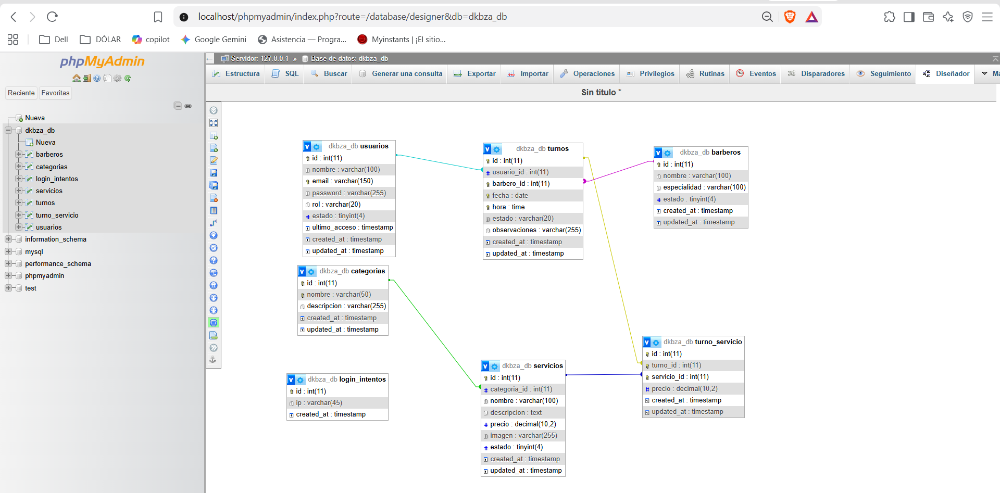

### 📐 Normalización

**Punto de partida:** sin normalizar, una reserva se anotaría en una sola fila, por ejemplo: `cliente, email, barbero, fecha, hora, servicios = "Corte, Barba", precios = "18000, 9000"`.

- **1FN (valores atómicos, sin grupos repetidos):** cada celda guarda un solo valor. Los servicios de un turno ya no van separados por comas, sino que cada uno es una fila de `turno_servicio`. Todas las tablas tienen clave primaria `id`.
- **2FN (sin dependencias parciales):** todo dato depende de la clave completa de su tabla. En el detalle, el nombre y la descripción del servicio dependen solo del servicio, no del par turno-servicio, así que van en `servicios`. En `turno_servicio` quedan únicamente `turno_id`, `servicio_id` y el precio cobrado.
- **3FN (sin dependencias transitivas):** ningún dato depende de otro campo que no sea la clave. El nombre y el email del cliente dependen del cliente, no del turno, por eso van en `usuarios`. Lo mismo pasa con el barbero (`barberos`) y con la categoría del servicio (`categorias`). En `turnos` solo se guardan sus claves foráneas.

**Decisiones de diseño:**
- `turno_servicio.precio` guarda el precio **del momento del turno**. Si mañana cambia el precio del servicio, los turnos pasados conservan lo que se cobró. Es un dato histórico, no una copia redundante.
- `UNIQUE (barbero_id, fecha, hora)` impide dar dos turnos al mismo barbero en el mismo horario, y `UNIQUE (turno_id, servicio_id)` impide repetir un servicio dentro de un turno.
- Los `CHECK` limitan `rol` a `admin`/`usuario` y el estado del turno a `pendiente`, `confirmado`, `cancelado` o `completado`.
- Las FK definen qué pasa al borrar:
  - si se borra un turno, se borra su detalle (`CASCADE`);
  - no se puede borrar un servicio o un barbero que tenga turnos (`RESTRICT`);
  - si se borra una categoría, sus servicios quedan sin categoría (`SET NULL`).
- Índices: `idx_servicios_estado`, porque el sitio siempre filtra los servicios activos, e `idx_turnos_fecha`, para buscar la agenda por día y hora.
- Todas las tablas usan `INT AUTO_INCREMENT PRIMARY KEY`, nombres en `snake_case` y fechas de auditoría `created_at` / `updated_at`.

> La tabla `usuarios` tiene la estructura que pide el TP8 (`nombre`, `email`, `password`, `rol`). El login la usa desde el TP8 (ver [Clase 8](#-clase-8-sesiones-autenticación-y-roles)).

### 🧪 Consultas de prueba (`consultas.sql`)

| Operación | Qué hace |
|---|---|
| `INSERT` | 3 categorías, 2 barberos, 3 servicios, 2 clientes, 3 turnos y su detalle |
| `SELECT` + `WHERE` + `ORDER BY` | Servicios activos, del más caro al más barato |
| `INNER JOIN` | Turnos con el nombre del cliente y del barbero; servicios y total de cada turno |
| `UPDATE` + `WHERE` | Confirma el turno 1 y cancela el turno 3 |
| `DELETE` + `WHERE` | Borra el turno cancelado; por `ON DELETE CASCADE` también se borra su detalle |

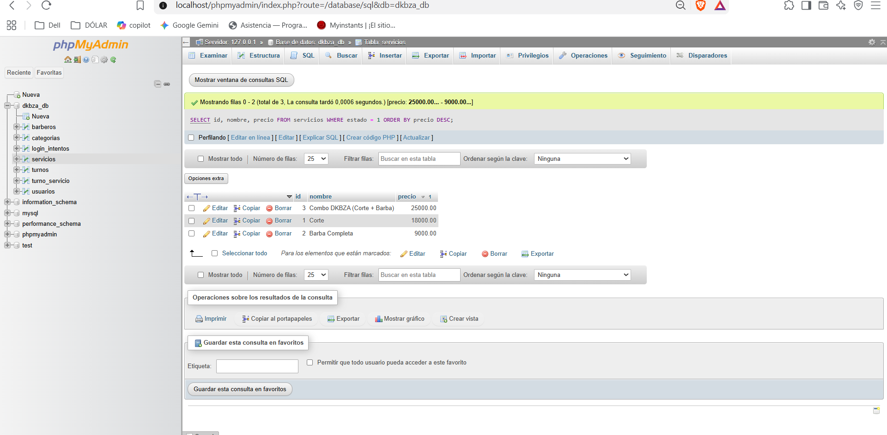

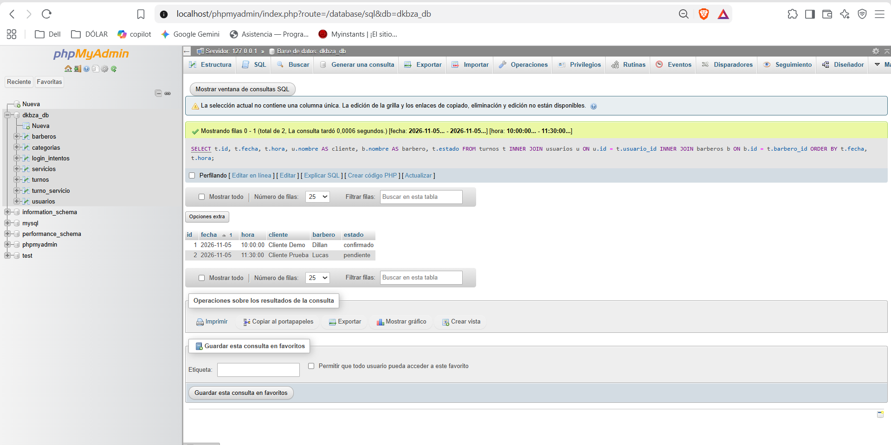

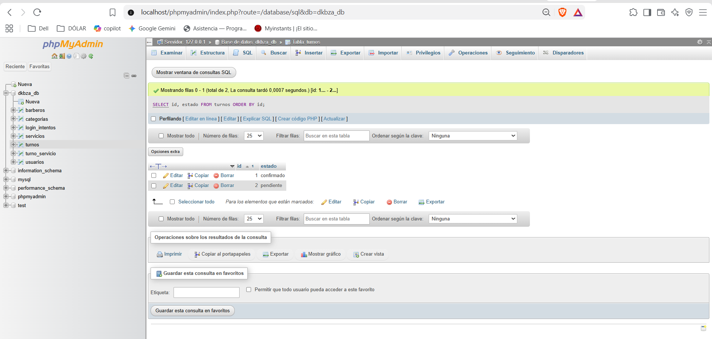

---

## 🗄️ Clase 7: Persistencia PHP-MySQL Segura (PDO + CRUD)

El sitio se conectó a una base de datos MySQL. Versión entregada: etiqueta [`tp7`](https://github.com/ArapaDillan10/Pagina-para-barberias/tree/tp7).

🔗 **Probar localmente:** <http://localhost/Barberias/> · Panel: <http://localhost/Barberias/login.php>

### 🧩 Modelo de datos

El modelo se diseñó con los criterios de la Clase 6: nombres en `snake_case`, clave primaria autoincremental, precios en `DECIMAL(10,2)`, un campo `estado` para mostrar u ocultar el servicio y fechas de auditoría. El script completo está en [`database/dkbza_db.sql`](database/dkbza_db.sql).

```sql
CREATE TABLE servicios (
  id          INT AUTO_INCREMENT PRIMARY KEY,
  nombre      VARCHAR(100) NOT NULL,
  descripcion TEXT,
  precio      DECIMAL(10, 2) NOT NULL,
  imagen      VARCHAR(255),
  estado      TINYINT NOT NULL DEFAULT 1,
  created_at  TIMESTAMP DEFAULT CURRENT_TIMESTAMP,
  updated_at  TIMESTAMP DEFAULT CURRENT_TIMESTAMP ON UPDATE CURRENT_TIMESTAMP
) ENGINE=InnoDB;
```

### 🔌 Conexión segura (`config/conexion.php`)

- Conexión con **PDO** y charset `utf8mb4`.
- Las credenciales se leen del `.env` con `env()`. No están escritas en el código y el `.env` no se sube al repositorio.
- `PDO::ERRMODE_EXCEPTION` para manejar errores con `try-catch`, `PDO::FETCH_ASSOC` por defecto y `PDO::ATTR_EMULATE_PREPARES => false` para usar sentencias preparadas reales.
- Si la conexión falla, el detalle técnico se guarda con `error_log()` y el usuario solo ve un mensaje neutro.


### 🛠️ CRUD de servicios en el Panel Admin

| Operación | Archivo | Consulta |
|---|---|---|
| **Create** | `crear_servicio.php` | `INSERT INTO servicios (...) VALUES (:nombre, :descripcion, :precio, :imagen, :estado)` |
| **Read** | `admin_servicios.php` / `servicios.php` | `SELECT ... FROM servicios` (la página pública filtra por `estado = 1`) |
| **Update** | `editar_servicio.php` | `UPDATE servicios SET ... WHERE id = :id` |
| **Delete** | `eliminar_servicio.php` | `DELETE FROM servicios WHERE id = :id` |

- El **dashboard** (`admin.php`) muestra la cantidad real de servicios activos con un `COUNT(*)`.
- **Alta y edición** comparten el formulario `includes/form_servicio.php`, con validación en el servidor: nombre obligatorio de hasta 100 caracteres y precio numérico positivo. Si hay errores, se muestran y los datos cargados se conservan.
- **Imagen del servicio:** el formulario usa `enctype="multipart/form-data"`. Las imágenes se validan con `getimagesize()` (solo JPG, PNG o WEBP de hasta 2 MB), se guardan con un nombre único generado en `img/servicios/` y en la base se registra solo la ruta. Al editar, si no se elige una imagen nueva, se mantiene la anterior. Si se reemplaza o se elimina el servicio, se borra el archivo viejo.
- **Eliminación con confirmación:** el enlace "Eliminar" abre una pantalla de confirmación, y el borrado se ejecuta solo al enviarla por `POST`.
- Después de cada operación se redirige al listado (patrón Post/Redirect/Get) con un mensaje de éxito.

**Listado de servicios:**


**Alta de un servicio con imagen:**


**Edición (muestra la imagen actual):**


**Confirmación antes de eliminar:**


**El servicio agregado desde el panel aparece en la página pública:**


### 🔒 Seguridad

- **Inyección SQL:** todas las consultas usan **sentencias preparadas** con parámetros nombrados (`:id`, `:nombre`, `:busqueda_nombre`...). Los datos del usuario nunca se concatenan en el SQL. Los `id` se validan además con `FILTER_VALIDATE_INT`.
- **XSS:** todo lo que viene de la base o de un formulario se imprime con `htmlspecialchars(..., ENT_QUOTES, 'UTF-8')` mediante la función `e()`.
- El buscador GET de `servicios.php` ahora consulta la base con `LIKE` y parámetros preparados. Buscar `' OR '1'='1` no devuelve todos los registros:


### 🛡️ Login y seguridad del panel

Antes, el panel se "protegía" con un `prompt()` de JavaScript y la contraseña estaba escrita en `script.js`: cualquiera podía leerla con Ctrl+U o entrar escribiendo `admin.php` en la barra. Ahora el control lo hace el servidor con PHP y sesiones.

| Riesgo | Medida aplicada | Archivo |
|---|---|---|
| Contraseña a la vista | Se eliminó la clave de `script.js`. Los usuarios están en la tabla `usuarios` y la contraseña se guarda cifrada con `password_hash()` (bcrypt) y se valida con `password_verify()` | `login.php`, `database/crear_admin.php` |
| Entrar por URL sin login | Todas las páginas del panel incluyen el guardián de sesión, que redirige a `login.php` si no hay sesión (desde el TP8, `includes/auth_guard.php`) | `includes/auth_guard.php` |
| Robo de sesión | `session_regenerate_id(true)` al ingresar, cookie `HttpOnly` + `SameSite=Strict`, `use_strict_mode` y cierre automático a los 30 minutos sin uso | `includes/sesion.php`, `includes/auth_guard.php` |
| Fuerza bruta | Los intentos fallidos se guardan en `login_intentos`: al 5.º error la IP queda bloqueada 15 minutos | `login.php` |
| CSRF | Login, logout, alta, edición y baja llevan un token aleatorio (`random_bytes`) que se verifica con `hash_equals()` | `includes/sesion.php` |
| Cerrar sesión de verdad | `logout.php` solo acepta POST con token, vacía `$_SESSION`, borra la cookie y hace `session_destroy()` | `logout.php` |
| Páginas del panel en caché | Cabecera `Cache-Control: no-store`: con "Atrás" no se ve el panel después de salir | `includes/auth_guard.php` |
| Usuario `root` en la conexión | El sitio usa `dkbza_app`, que solo tiene `SELECT, INSERT, UPDATE, DELETE` sobre `dkbza_db` (no puede borrar tablas ni ver otras bases) | `database/seguridad.sql` |
| Archivos internos accesibles | `.htaccess` bloquea `.env`, `.sql`, archivos ocultos y las carpetas `config/`, `includes/` y `database/`; sin listado de carpetas | `.htaccess` |
| Subida de archivos maliciosos | En `img/servicios/` no se ejecuta PHP aunque se suba un archivo con esa extensión | `img/servicios/.htaccess` |
| Clickjacking y otros | Cabeceras `X-Frame-Options`, `X-Content-Type-Options`, `Referrer-Policy` y `Permissions-Policy` | `.htaccess` |

Además, `crear_admin.php` solo funciona desde la terminal (en el navegador responde "Acceso denegado"), así nadie puede crearse un usuario desde la web.

**Pantalla de ingreso** (versión del TP7, con usuario en vez de email):


**Contraseña incorrecta**, con el contador de intentos:


**Cierre de sesión:** después de salir hay que volver a ingresar.


**El `.env` no se puede abrir desde el navegador:**


**Contraseña cifrada en la base:** solo se guarda el hash, nunca la contraseña real.


---

## 🔐 Clase 8: Sesiones, Autenticación y Roles

El sitio pasó de tener un único usuario del panel a un sistema de cuentas: cualquier persona puede registrarse, entra con su email y ve una página u otra según su **rol** (`admin` o `usuario`). Se usa la tabla `usuarios` diseñada en el TP6.

🔗 **Probar localmente:** <http://localhost/Barberias/registro.php> · <http://localhost/Barberias/login.php>

### 📂 Archivos

| Archivo | Qué hace |
|---|---|
| `registro.php` | Alta de usuarios. Valida en el servidor, rechaza emails repetidos y guarda la contraseña con `password_hash($clave, PASSWORD_BCRYPT)`. El rol siempre es `usuario`: nunca se toma del formulario |
| `login.php` | Busca al usuario por email con una consulta preparada, valida con `password_verify()`, ejecuta `session_regenerate_id(true)` y guarda `$_SESSION['usuario_id']`, `$_SESSION['usuario_nombre']` y `$_SESSION['rol']`. Redirige al panel o a Mi cuenta según el rol |
| `includes/auth_guard.php` | `verificarSesion()`: sin sesión redirige a `login.php?error=acceso_denegado`. `verificarRol('admin')`: si el rol no coincide, redirige a `mi_cuenta.php?error=sin_permiso` |
| `mi_cuenta.php` | Vista para **cualquier usuario logueado**: sus datos y sus turnos (JOIN de `turnos`, `barberos`, `turno_servicio` y `servicios`) |
| `admin.php` y CRUD | Vista **exclusiva del administrador**: cada página empieza con `verificarRol('admin')` |
| `logout.php` | Solo por POST con token CSRF: vacía `$_SESSION`, borra la cookie con `session_get_cookie_params()`, hace `session_destroy()` y vuelve al login |
| `database/crear_admin.php` | Crea o actualiza un administrador desde la terminal (en el navegador responde "Acceso denegado") |

Uso del guardián al principio de cada página protegida:

```php
require_once __DIR__ . '/includes/auth_guard.php';   // cualquier usuario logueado
verificarRol('admin');                               // además, solo administradores
```

### ✅ Validaciones del registro

- **Nombre:** entre 2 y 100 letras (con tildes y ñ) y espacios. Se rechazan números, símbolos y etiquetas como `<script>`.
- **Email:** `filter_var(..., FILTER_VALIDATE_EMAIL)`, hasta 150 caracteres, guardado en minúsculas y único en la base.
- **Contraseña:** entre 8 y 72 caracteres (el límite de bcrypt), con letras y números, y repetida igual en la confirmación.
- Si hay errores se muestran todos juntos y se conservan el nombre y el email cargados, siempre escapados con `htmlspecialchars()`.

### 🛡️ Seguridad aplicada

| Riesgo | Medida |
|---|---|
| Contraseñas robadas de la base | Solo se guarda el hash bcrypt (`$2y$10$...`) |
| Inyección SQL | Todas las consultas usan PDO con parámetros preparados (`:email`, `:nombre`, ...) |
| XSS | Todo lo que viene del usuario se imprime con `e()` (`htmlspecialchars` con `ENT_QUOTES`) |
| Fijación de sesión | `session_regenerate_id(true)` al iniciar sesión y `use_strict_mode` |
| Escalada de privilegios | El rol lo asigna el servidor; `verificarRol('admin')` protege el panel |
| Enumeración de usuarios | El login responde "Email o contraseña incorrectos" sin decir cuál falló, y tarda lo mismo aunque el email no exista |
| Fuerza bruta | 5 intentos fallidos por IP bloquean el login 15 minutos (tabla `login_intentos`) |
| CSRF | Registro, login y logout llevan token y se verifica con `hash_equals()` |
| Sesión abandonada | Se cierra sola a los 30 minutos sin actividad |

### 📸 Evidencia

**Entrar a una página protegida sin sesión:**

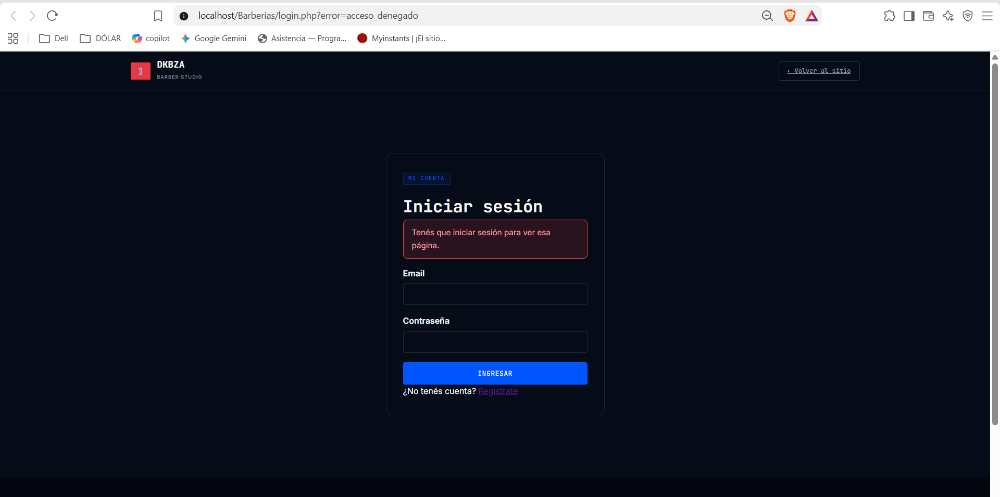

**Registro con datos inválidos** (el `<script>` vuelve como texto, sin ejecutarse):

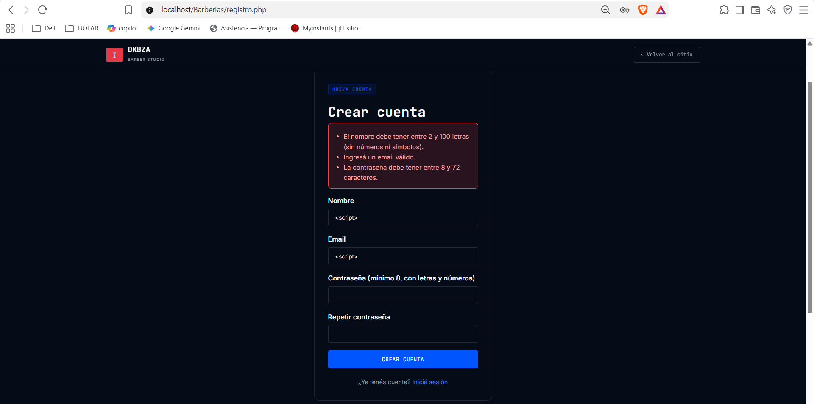

**Registro correcto:**

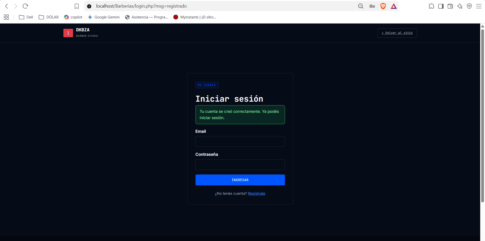

**Vista de un usuario común (`mi_cuenta.php`):**

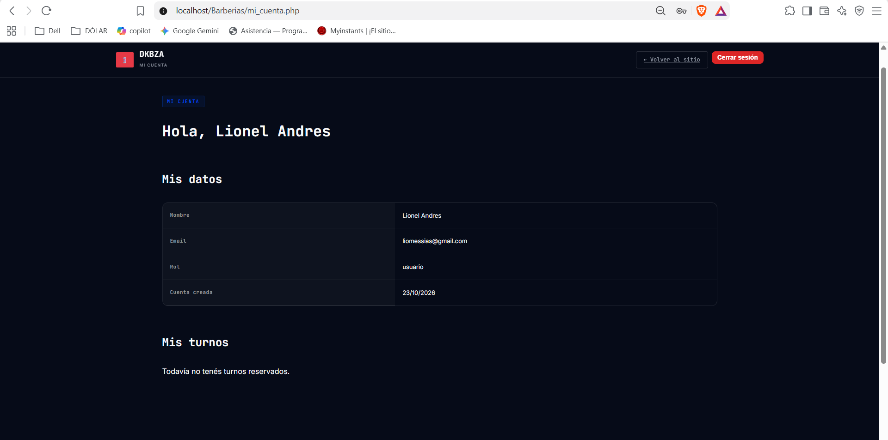

**Un usuario común intenta entrar al panel:**

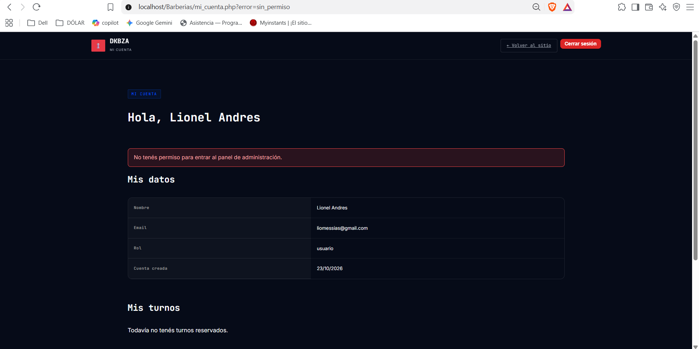

**Vista exclusiva del administrador:**

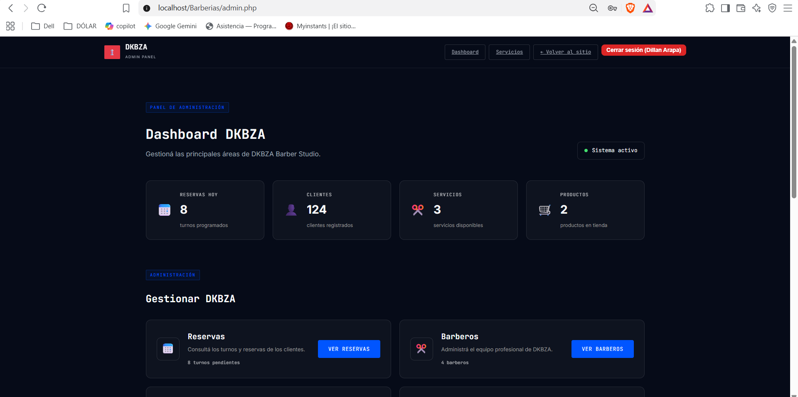

**Cierre de sesión:**

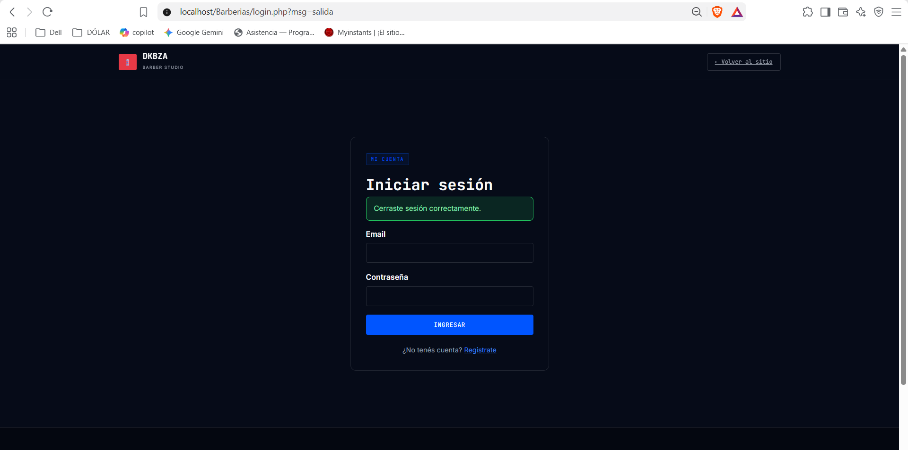

**Contraseñas cifradas y roles en la tabla `usuarios`:**

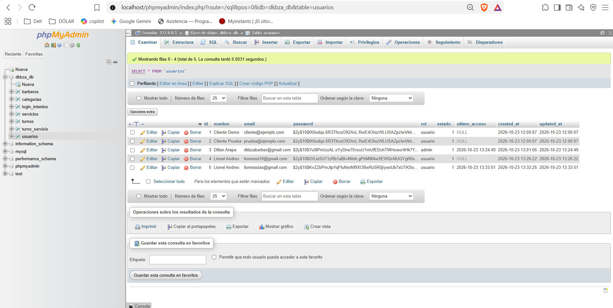

---

## 📊 Auditoría y optimización (Lighthouse)

Se realizó una auditoría de calidad y accesibilidad con Chrome DevTools (Hito 1), con estas puntuaciones:

- Performance: 80/100
- Accessibility: 85/100
- Best Practices: 100/100
- SEO: 90/100

---

Desarrollado por **Dillan Arapa** · Programación Web · 2026
